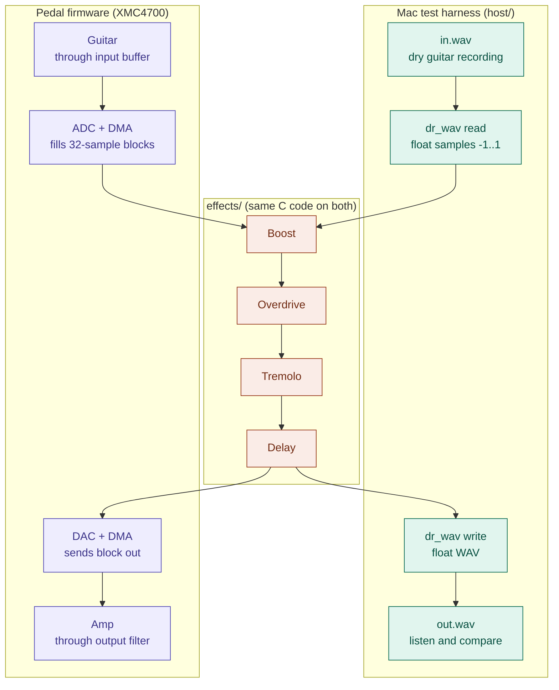
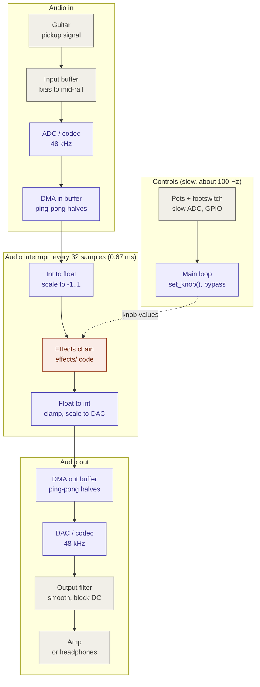

# Dataflow

How audio moves through the pedal, and how the same effects code is tested on a
computer before it runs on the XMC4700.

## Overview: one effects library, two homes

The code in `effects/` is plain C with no hardware access. On the Mac it is fed
from WAV files; on the pedal it is fed from the ADC. Only the outer boxes change.

## Pedal: real-time signal path

Audio moves in blocks. DMA fills one half of a buffer while the CPU processes the
other half, then they swap. Knobs are read separately at a much slower rate.

Colors: gray = analog hardware, purple = XMC4700 firmware, coral = shared effects
code, teal = Mac-only test code.

## Key numbers

| | Value | Why |
|---|---|---|
| Sample rate | 48 kHz | Covers hearing range (up to 24 kHz) with room for the anti-alias filter; standard for codecs |
| Block size | 32 samples per half | 0.67 ms per block keeps latency low; Lab7 used 256 (about 5 ms) |
| CPU budget | about 96,000 cycles per block | 144 MHz / 48 kHz = 3,000 cycles per sample |
| Sample format | `float`, -1..1 | Cortex-M4F has a single-precision FPU; `double` runs in software |
| Knob rate | about 100 Hz | Knobs are slow; values are smoothed inside each effect to avoid clicks |
