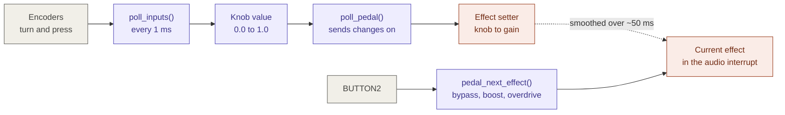

# Dataflow

_Last updated: 2026-11-12. If the code has changed since then, check this page
against it before trusting the details._

How audio and knob movements travel through the pedal firmware on the XMC4700.

## Signal path

Audio is handled one sample at a time. An interrupt fires 96,000 times a second;
each time it reads one sample from the ADC, runs the current effect on it, and
writes the result to the DAC.

```mermaid
flowchart LR
    subgraph analog_in["Analog in"]
        direction TB
        source["Guitar<br/>or line source"] --> bias["Input circuit<br/>bias to 1.65 V"]
    end

    subgraph interrupt["Audio interrupt: once per sample (96 kHz)"]
        direction TB
        adc["Read ADC<br/>12-bit, 4x averaged"] --> to_float["Int to float<br/>scale to -1..1"]
        to_float --> effect["Current effect<br/>api/effects"]
        effect --> to_int["Float to int<br/>clip to 12 bits"]
        to_int --> dac["Write DAC"]
    end

    subgraph analog_out["Analog out"]
        direction TB
        output["Output circuit"] --> amp["Amp<br/>or headphones"]
    end

    bias --> adc
    dac --> output

    classDef analog fill:#F1EFE8,stroke:#5F5E5A,color:#444441
    classDef firmware fill:#EEEDFE,stroke:#534AB7,color:#3C3489
    classDef effects fill:#FAECE7,stroke:#993C1D,color:#712B13
    class source,bias,output,amp analog
    class adc,to_float,to_int,dac firmware
    class effect effects
```

## Controls

Knobs and buttons are slow compared with audio, so they are read from the main
loop instead of the interrupt. The main loop does the slow math (turning a knob
value into a gain) and hands the effect a single finished number.

Colors: gray = hardware, purple = firmware, coral = effects code.

Each effect remembers its own knob values. Encoders have no marks or end stops,
so switching effects moves the knobs to where that effect was left.

## Where the code lives

| Folder | What it does |
|---|---|
| `main.c`, `main_helpers.c` | Start-up and the main loop |
| `api/audio` | The audio interrupt: ADC, effect, DAC, and the test modes |
| `api/adc`, `api/dac` | The converters |
| `api/digital_inputs` | Encoders and buttons |
| `api/pedal` | Which effect is on, and which knob controls what |
| `api/effects` | The effects themselves: plain math, no hardware access |

## Key numbers

| | Value | Why |
|---|---|---|
| Sample rate | 96 kHz | Keeps the DAC's stair-step artifacts far above hearing |
| Latency | 1 sample (about 10 microseconds) | Each sample is processed as soon as it is read |
| CPU budget | about 1,500 cycles per sample | 144 MHz / 96 kHz |
| Sample format in effects | `float`, -1..1 | The chip has a single-precision FPU; `double` runs in slow software |
| Converters | 12-bit in, 12-bit out | Built into the XMC4700 |
| Knob polling | every 1 ms | Fast enough to never miss an encoder click |
| Knob smoothing | 10 Hz | Changes glide over about 50 ms so they do not click |
