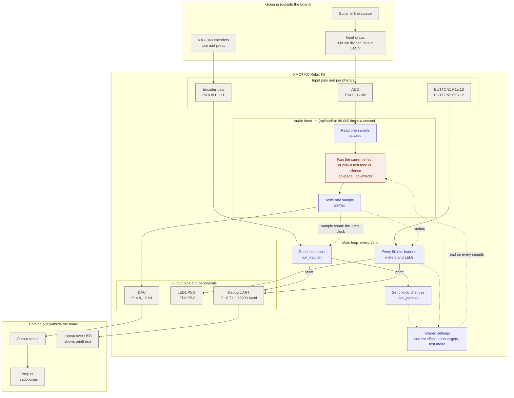

# System overview

_Last updated: 2026-11-12. If the code has changed since then, check this page
against it before trusting the details._

The whole pedal on one page: what is wired to the board, and what the firmware
does with it. For a closer look at the audio path and the knobs, see
[Dataflow](dataflow.md).

Colors: gray = hardware, purple = firmware, coral = effects code.
Solid arrows are signals and function calls. Dotted arrows are values the two
parts of the firmware share in memory (listed in the table below).

## How it works

The firmware has two parts running at very different speeds.

**The audio interrupt** is the fast one. A timer fires 96,000 times a second,
and each time the chip reads one sample from the ADC, runs the current effect
on it, and writes the result to the DAC. There are about 1,500 processor cycles
per sample in total, and an effect should use no more than about 1,200 of them,
so it only does quick math and never waits for anything.

**The main loop** is the slow one. It has no timer of its own: it counts audio
samples, and every 96 samples (1 ms) it reads the encoders and passes any knob
change on to the current effect. Every 50 ms it also checks the two on-board
buttons and updates the two LEDs. `printf` is only ever called from here.

At power-on the pedal plays a 1 kHz beep for one second, then switches to
normal playing. If you hear the beep, the DAC and the output circuit work.

The two parts never call each other's functions. They only share a few small
values:

| Shared value | Written by | Read by |
|---|---|---|
| Which effect is on | Main loop (BUTTON2) | Audio interrupt |
| Knob targets (gain, drive, level) | Main loop (encoders, and BUTTON2 restoring an effect's saved knobs) | Audio interrupt, which glides toward them |
| Test mode (normal, tone, silence) | Main loop (BUTTON1, and the boot beep) | Audio interrupt |
| Sample count | Audio interrupt | Main loop, as its 1 ms clock |
| Input average and output peak | Audio interrupt | Main loop, every 50 ms, for LED2 |

## What each part does

| Part | Job |
|---|---|
| Input circuit | Lifts the audio signal to sit around 1.65 V, the middle of the ADC's range |
| ADC | Turns the input voltage into a number, 0 to 4095 |
| Effect | Changes the sample: boost makes it louder, overdrive distorts it, bypass leaves it alone |
| DAC | Turns the number back into a voltage |
| Encoders | Four knobs, each 0.0 to 1.0 in 40 clicks. `api/pedal` decides what they control: boost uses knob 0 for gain; overdrive uses knob 0 for drive and knob 1 for level. Each effect remembers where its knobs were left |
| BUTTON1 | Cycles the test mode: normal, 1 kHz test tone, silence. Effects are only heard in normal mode |
| BUTTON2 | Steps to the next effect: bypass, boost, overdrive |
| LED1 | Shows the test mode: slow blink = normal, fast blink = tone, solid = silence |
| LED2 | Blinks fast if the input bias is wrong; otherwise lights when there is output signal |
| Debug UART | Carries `printf` text to the laptop through the board's USB debugger |

Four more button inputs (P0.12 to P0.15) are read by the firmware but nothing
uses them yet.
